# Modelo de datos (Hito 3)

Motor: PostgreSQL 16, con TypeORM. La estructura y los datos de prueba se crean **solo con migraciones de
TypeORM** ([`src/database/migrations`](../src/database/migrations)). El ORM nunca modifica el esquema por su
cuenta (`synchronize: false`).

## Migraciones

| # | Migración | Qué hace |
|---|---|---|
| 1 | `EsquemaInicial1788220800000` | Hito 2: usuarios, libros, carrito, pedidos y pagos |
| 2 | `DatosPruebaIniciales1788220800001` | Hito 2: 3 cuentas (una por rol) y 24 libros |
| 3 | `EsquemaHito31792022400000` | Hito 3: cuenta, ficha ampliada del libro, categorías, reseñas, libreros, listas de deseos, club de lectura, cupones, newsletter y compra como invitado |
| 4 | `DatosPruebaHito31792022400001` | Hito 3: categorías del menú, 51 libros más, 10 cuentas, 5 libreros, reseñas, cupones y un club |
| 5 | `CierreHito31794355200000` | Imágenes subidas, direcciones guardadas, preguntas al librero, RUT/ciudad/código postal del despacho y versión de sesión |
| 6 | `DatosPruebaCierreHito31794355200001` | Subgénero de todos los libros, galería y video para la demo |

- **Al arrancar**, la API aplica las migraciones pendientes (`DB_MIGRAR_AL_INICIAR=true`): en el servidor
  basta con levantar una versión nueva de la imagen.
- **A mano**: `npm run migration:show`, `npm run migration:run` y `npm run migration:revert`
  (dentro del contenedor: `docker compose exec api npm run typeorm -- migration:show`).
- **Cambios nuevos**: `npm run migration:generate -- src/database/migrations/NombreDelCambio` compara las
  entidades con la base y escribe la migración.
- Todas tienen `down`: se pueden revertir una a una hasta dejar la base vacía. Al revertir datos de prueba se
  conservan las filas que ya tienen pedidos asociados.
- Las migraciones 1 a 4 son idempotentes (`IF NOT EXISTS`, `ON CONFLICT DO NOTHING`), así que también se
  aplicaron sin problemas sobre la base del servidor, que se había creado con los scripts SQL de hitos
  anteriores.
- Los registros de cada ejecución quedan en la tabla `migraciones_typeorm`.

## Diagrama entidad-relación

```mermaid
erDiagram
    USUARIOS ||--o{ CARRITO_ITEMS : "tiene en su carrito"
    LIBROS ||--o{ CARRITO_ITEMS : "está en"
    USUARIOS |o--o{ PEDIDOS : "realiza (o invitado)"
    PEDIDOS ||--|{ PEDIDO_ITEMS : "contiene"
    LIBROS ||--o{ PEDIDO_ITEMS : "se vendió en"
    PEDIDOS ||--o{ PAGOS : "recibe intentos de"
    CUPONES |o--o{ PEDIDOS : "se aplica en"
    USUARIOS ||--o{ DIRECCIONES : "guarda"
    USUARIOS ||--o{ TOKENS_USUARIO : "recibe"
    LIBROS ||--o{ RESENAS : "recibe"
    USUARIOS ||--o{ RESENAS : "escribe"
    USUARIOS |o--o| LIBREROS : "tiene perfil"
    LIBREROS ||--o{ LIBRERO_SEGUIDORES : "es seguido"
    USUARIOS ||--o{ LIBRERO_SEGUIDORES : "sigue"
    LIBREROS ||--o{ RECOMENDACIONES_LIBRERO : "recomienda"
    LIBROS ||--o{ RECOMENDACIONES_LIBRERO : "es recomendado"
    LIBREROS ||--o{ COLECCIONES : "publica"
    LIBREROS ||--o{ PREGUNTAS_LIBRERO : "recibe"
    USUARIOS |o--o{ PREGUNTAS_LIBRERO : "pregunta"
    USUARIOS ||--o{ LISTAS_DESEOS : "arma"
    LISTAS_DESEOS ||--o{ LISTA_DESEOS_LIBROS : "incluye"
    LIBROS ||--o{ LISTA_DESEOS_LIBROS : "está en"
    LIBROS ||--o{ CLUBES_LECTURA : "se lee en"
    USUARIOS |o--o{ CLUBES_LECTURA : "crea"
    CLUBES_LECTURA ||--o{ CLUB_PARTICIPANTES : "tiene"
    USUARIOS ||--o{ CLUB_PARTICIPANTES : "participa"
    CLUBES_LECTURA ||--o{ CLUB_HILOS : "tiene"
    CLUB_HILOS ||--o{ CLUB_COMENTARIOS : "tiene"
    USUARIOS ||--o{ CLUB_HILOS : "abre"
    USUARIOS ||--o{ CLUB_COMENTARIOS : "comenta"
    USUARIOS |o--o{ SUSCRIPCIONES_NEWSLETTER : "se suscribe"
    LIBROS |o--o{ IMAGENES : "portada y galería"
    USUARIOS |o--o{ IMAGENES : "sube"

    USUARIOS {
        uuid id PK
        varchar nombre
        varchar apellido
        varchar email UK
        varchar password_hash "bcrypt; null si entra con Google o Facebook"
        varchar rol "CLIENTE | LIBRERO | ADMIN"
        text_array generos_favoritos
        text avatar_url
        boolean recibir_novedades
        boolean email_verificado
        varchar proveedor_auth "LOCAL | GOOGLE | FACEBOOK"
        varchar proveedor_id
        int version_sesion "cerrar sesión invalida los refresh"
        timestamptz creado_en
        timestamptz actualizado_en
    }
    TOKENS_USUARIO {
        uuid id PK
        uuid usuario_id FK
        varchar tipo "VERIFICACION_EMAIL | RECUPERACION_PASSWORD"
        char token_hash UK "SHA-256"
        timestamptz expira_en
        timestamptz usado_en
    }
    LIBROS {
        uuid id PK
        varchar isbn UK
        varchar titulo
        varchar autor
        varchar genero
        varchar subgenero
        text descripcion "se expone como sinopsis"
        varchar editorial
        int anio_publicacion
        varchar formato "FISICO | EBOOK | AUDIOLIBRO"
        varchar estado "DISPONIBLE | PREVENTA"
        int precio "CLP"
        int precio_anterior "oferta: mayor que precio"
        int stock
        text portada_url
        text_array galeria
        text video_url
        varchar encuadernacion
        int paginas
        varchar dimensiones
        text_array etiquetas
        text_array categorias
        numeric calificacion
        int opiniones
        int ventas
        boolean activo "borrado lógico"
        timestamptz fecha_ingreso
    }
    CATEGORIAS {
        varchar nombre PK
        varchar tipo "GENERO | TEMATICA"
        varchar grupo
        int orden
    }
    IMAGENES {
        uuid id PK
        varchar archivo UK "nombre en disco"
        varchar nombre_original
        varchar mime "image/jpeg | png | webp"
        int tamano "bytes"
        text url
        varchar uso "PORTADA | GALERIA | GENERAL"
        uuid libro_id FK
        uuid subido_por FK
        timestamptz creado_en
    }
    CARRITO_ITEMS {
        uuid usuario_id PK, FK
        uuid libro_id PK, FK
        int cantidad "1 a 10"
        timestamptz agregado_en
    }
    DIRECCIONES {
        uuid id PK
        uuid usuario_id FK
        varchar alias
        varchar nombre_receptor
        varchar rut
        varchar calle
        varchar comuna
        varchar ciudad
        varchar region
        varchar codigo_postal
        varchar telefono
        boolean predeterminada "una por usuario"
    }
    PEDIDOS {
        uuid id PK
        serial numero UK "LCN-000123"
        uuid usuario_id FK "null si es invitado"
        varchar invitado_email
        varchar invitado_nombre
        varchar estado "PENDIENTE_PAGO | PAGADO | CANCELADO"
        varchar metodo_envio "DESPACHO | RETIRO"
        int subtotal
        int descuento
        varchar codigo_descuento FK
        int costo_envio
        int total "subtotal - descuento + costo_envio"
        int dias_estimados
        varchar dir_receptor
        varchar dir_rut
        varchar dir_calle
        varchar dir_comuna
        varchar dir_ciudad
        varchar dir_region
        varchar dir_codigo_postal
        varchar dir_telefono
        varchar codigo_seguimiento
        timestamptz creado_en
        timestamptz pagado_en
        timestamptz cancelado_en
    }
    PEDIDO_ITEMS {
        uuid id PK
        uuid pedido_id FK
        uuid libro_id FK
        varchar titulo "copia al comprar"
        int precio_unitario "copia al comprar"
        int cantidad
        int subtotal
    }
    PAGOS {
        uuid id PK
        uuid pedido_id FK
        int monto
        varchar metodo "TARJETA_CREDITO | TARJETA_DEBITO"
        varchar estado "APROBADO | RECHAZADO"
        char ultimos4
        varchar codigo_autorizacion
        varchar motivo_rechazo
    }
    CUPONES {
        varchar codigo PK
        varchar tipo "PORCENTAJE | MONTO_FIJO"
        int valor
        int monto_minimo
        int usos_maximos
        int usos
        boolean un_uso_por_usuario
        timestamptz vigente_desde
        timestamptz vigente_hasta
        boolean activo
    }
    RESENAS {
        uuid id PK
        uuid libro_id FK
        uuid usuario_id FK
        varchar tipo "LECTOR | LIBRERO"
        int calificacion "1 a 5"
        varchar titulo
        text comentario
        boolean verificada "compró el libro"
    }
    LIBREROS {
        uuid id PK
        uuid usuario_id FK, UK
        varchar slug UK
        varchar nombre
        varchar nombre_corto
        text cita
        text biografia
        text foto_url
        text_array etiquetas
        text_array estilos
        text_array autores_favoritos
        jsonb indispensables "top 5"
        boolean activo
    }
    LIBRERO_SEGUIDORES {
        uuid librero_id PK, FK
        uuid usuario_id PK, FK
    }
    RECOMENDACIONES_LIBRERO {
        uuid id PK
        uuid librero_id FK
        uuid libro_id FK
        text nota
        boolean destacada "va al Home"
        int orden
    }
    COLECCIONES {
        uuid id PK
        uuid librero_id FK
        varchar titulo
        text descripcion
        date publicada_en
        uuid_array libros
    }
    PREGUNTAS_LIBRERO {
        uuid id PK
        uuid librero_id FK
        uuid usuario_id FK "null si no inició sesión"
        varchar nombre
        varchar email
        text pregunta
        text respuesta
        timestamptz respondida_en
    }
    LISTAS_DESEOS {
        uuid id PK
        uuid usuario_id FK
        varchar nombre
        boolean es_para_regalo
        boolean es_favoritos
    }
    LISTA_DESEOS_LIBROS {
        uuid lista_id PK, FK
        uuid libro_id PK, FK
    }
    CLUBES_LECTURA {
        uuid id PK
        uuid libro_id FK
        uuid creador_id FK
        varchar titulo
        text descripcion
        date fecha_inicio
        date fecha_fin
    }
    CLUB_PARTICIPANTES {
        uuid club_id PK, FK
        uuid usuario_id PK, FK
        int pagina_actual
        int porcentaje
    }
    CLUB_HILOS {
        uuid id PK
        uuid club_id FK
        uuid usuario_id FK
        varchar titulo
        text contenido
    }
    CLUB_COMENTARIOS {
        uuid id PK
        uuid hilo_id FK
        uuid usuario_id FK
        text contenido
    }
    SUSCRIPCIONES_NEWSLETTER {
        varchar email PK
        uuid usuario_id FK
        boolean activa
        uuid token_baja UK
    }
```

Se omiten las fechas de creación y actualización que no aportan a la relación entre tablas. La tabla
`migraciones_aplicadas` es un registro interno del script del Hito 3 y no se relaciona con las demás.

## Decisiones

| Decisión | Motivo |
|---|---|
| Migraciones de TypeORM en vez de scripts SQL sueltos | La base del servidor queda lista al levantar una versión nueva de la imagen, y cada cambio queda versionado con el código |
| Identificadores UUID | No exponen cuántos usuarios o pedidos existen y los puede generar cualquier capa |
| Dinero como `INTEGER` en CLP | El peso chileno no tiene decimales: se evitan errores de redondeo |
| `pedido_items` y la dirección del pedido son copias | El pedido debe mostrar lo que se cobró y adónde se envió aunque el catálogo o la libreta cambien después |
| Libreta de direcciones aparte (`direcciones`) | "Usar mi dirección guardada" sin perder la foto exacta en cada pedido |
| El stock se descuenta al crear el pedido | Reserva las unidades mientras se paga; cancelar las devuelve |
| Borrado lógico de libros (`activo`) | Los pedidos históricos siguen apuntando al libro |
| Restricciones `CHECK` e índices únicos parciales | La base rechaza por sí sola stock negativo, totales que no cuadran, dos pagos aprobados por pedido o dos direcciones predeterminadas |
| Imágenes en disco, metadatos en `imagenes` | Los archivos los sirve el servidor de estáticos (`/uploads`); la base guarda quién los subió, para qué libro y su URL. En Docker la carpeta es un volumen |
| `version_sesion` en `usuarios` | Cerrar sesión invalida todos los refresh tokens del usuario sin tener que guardar cada token |
| `pagos` no guarda número de tarjeta ni CVV | Solo los últimos 4 dígitos, aunque la pasarela sea ficticia |
| `tokens_usuario` guarda el SHA-256 | Si la base se filtra, los enlaces de verificación y recuperación no se pueden usar |
