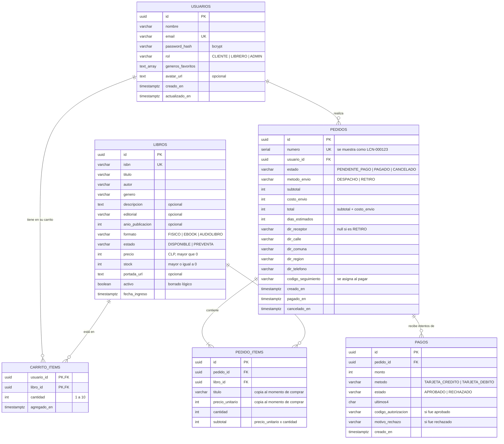

# Modelo de datos · primera versión (Hito 2)

Motor: PostgreSQL 16. La estructura se crea con [`db/01-schema.sql`](../db/01-schema.sql) y los datos de
prueba con [`db/02-seed.sql`](../db/02-seed.sql). El ORM (TypeORM) nunca modifica la estructura (`synchronize: false`).

## Diagrama entidad-relación

## Decisiones

| Decisión | Motivo |
|---|---|
| Identificadores UUID | No exponen cuántos usuarios o pedidos existen y los puede generar cualquier capa |
| Dinero como `INTEGER` en CLP | El peso chileno no tiene decimales: se evitan errores de redondeo |
| El carrito no tiene tabla propia | Un usuario tiene un solo carrito: basta `carrito_items` con llave `(usuario_id, libro_id)` |
| `pedido_items` copia título y precio | El pedido debe mostrar lo que se cobró aunque el catálogo cambie después |
| El stock se descuenta al crear el pedido | Reserva las unidades mientras se paga; cancelar las devuelve |
| Dirección dentro de `pedidos` | Todavía no hay libreta de direcciones. Si UX/UI la define, pasa a una tabla propia |
| Borrado lógico de libros (`activo`) | Los pedidos históricos siguen apuntando al libro |
| Restricciones `CHECK` | La base rechaza por sí sola stock negativo, totales que no cuadran o estados inexistentes |
| Índice único parcial en `pagos` | Garantiza a nivel de base que un pedido tenga a lo más un pago aprobado |
| `pagos` no guarda número de tarjeta ni CVV | Solo los últimos 4 dígitos, aunque la pasarela sea ficticia |

## Fuera de la base por ahora

Reseñas, listas de deseos, perfiles de librero y club de lectura siguen en memoria en este hito.
Su modelado en PostgreSQL (con llaves foráneas a `usuarios` y `libros`) queda para el Hito 3.

## Tablas agregadas en el Hito 3

Definidas en `db/03-hito3-schema.sql` (idempotente; también migra una base del Hito 2 con datos).

| Tabla | Para qué |
|---|---|
| `categorias` | Menú de UX: géneros (agrupados en Ficción, No ficción, ...) y temáticas |
| `resenas` | Reseñas de lectores y libreros (una por usuario y libro; `verificada` si lo compró) |
| `libreros`, `librero_seguidores` | Perfiles editoriales (slug, biografía, top 5 en JSONB) y sus seguidores |
| `recomendaciones_librero`, `colecciones` | Libros recomendados con nota (los `destacada` van al Home) y colecciones |
| `listas_deseos`, `lista_deseos_libros` | Listas de deseos; una por usuario es la de "Favoritos" |
| `clubes_lectura`, `club_participantes`, `club_hilos`, `club_comentarios` | Club de lectura y progreso de cada participante |
| `cupones` | Códigos de descuento (porcentaje o monto fijo, vigencia, mínimo y usos) |
| `suscripciones_newsletter` | Emails suscritos y token de baja |
| `tokens_usuario` | SHA-256 de los tokens de verificación de correo y recuperación de contraseña |
| `migraciones_aplicadas` | Migraciones de datos que deben correr una sola vez |

Columnas nuevas:

- `usuarios`: `apellido`, `recibir_novedades`, `email_verificado`, `proveedor_auth`, `proveedor_id`;
  `password_hash` pasa a ser opcional (cuentas de Google/Facebook).
- `libros`: `precio_anterior` (mayor que `precio`), `subgenero`, `encuadernacion`, `paginas`, `dimensiones`,
  `etiquetas`, `categorias`, `video_url`, `galeria` y las estadísticas desnormalizadas `calificacion`,
  `opiniones` y `ventas`.
- `pedidos`: `descuento`, `codigo_descuento`, `invitado_email`, `invitado_nombre`; `usuario_id` pasa a ser
  opcional y la regla del total queda `total = subtotal - descuento + costo_envio`.
