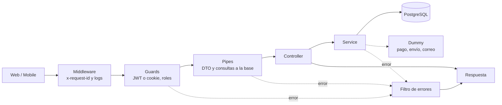

# Arquitectura general

NestJS 11 con TypeScript, organizado por **módulos de dominio** (uno por funcionalidad del negocio), sobre
PostgreSQL 16 con TypeORM.

## Recorrido de una petición

| Capa | Qué hace | Dónde |
|---|---|---|
| Middleware | Genera o reutiliza el `x-request-id`, registra la entrada (fecha, método, path, body sin datos sensibles) y la salida (código y tiempo) | `common/middleware` |
| Guards | `JwtAuthGuard` global: acepta `Authorization: Bearer` o la cookie HttpOnly; `RolesGuard` aplica `@Roles()` | `modules/auth/guards` |
| Pipes | `ValidationPipe` global con los DTO; `UuidPipe`; `LibroExistePipe` y `LibreroExistePipe` consultan la base | `common/pipes`, `modules/*/pipes` |
| Controllers | Rutas HTTP y documentación Swagger; no tienen lógica de negocio | `modules/*/*.controller.ts` |
| Services | Lógica de negocio y transacciones | `modules/*/*.service.ts` |
| Filtro | Convierte cualquier error en `ErrorResponseDto` con un código estable | `common/filters` |

## Módulos

| Grupo | Módulos |
|---|---|
| Cuenta | `auth`, `usuarios`, `direcciones` |
| Catálogo | `libros`, `imagenes`, `resenas`, `libreros`, `recomendaciones` |
| Compra | `carrito`, `cupones`, `pedidos`, `pagos` (dummy), `envios` (dummy), `seguimiento` (dummy) |
| Comunidad | `listas-deseos`, `club-lectura`, `newsletter` |
| Soporte | `mail` (dummy), `admin` |

## Transversal

- **Configuración** (`config/`): valida las variables de entorno al arrancar y expone la versión de
  `package.json` (en Swagger y en `/health`).
- **Base de datos** (`database/`): la conexión compartida por la app y la CLI de TypeORM, y las migraciones.
- **Archivos estáticos**: las imágenes subidas se sirven en `/uploads/*` desde `UPLOADS_DIR`.

Más detalle de la estructura de carpetas en el
[README](https://github.com/bootcamp-uchile-2026/grupo-5-backend#6-estructura-del-proyecto).
