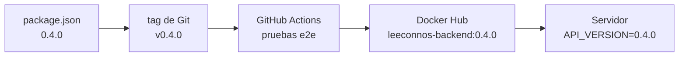

# Versionado y despliegue

El servidor nunca compila código: ejecuta una imagen versionada de Docker Hub y se actualiza cambiando la
versión de esa imagen. El paso a paso completo está en
[`docs/despliegue.md`](https://github.com/bootcamp-uchile-2026/grupo-5-backend/blob/main/docs/despliegue.md).



## Versiones estables

| Versión | Tag | Contenido |
|---|---|---|
| 0.4.0 | `v0.4.0` y `hito-3` (se crean al integrar a `main`) | Cierre del Hito 3: migraciones, imágenes, cookies HttpOnly, direcciones, preguntas al librero |
| 0.3.0 | — | Hito 3, primera parte: lo que UX diseñó y la API no tenía |
| 0.2.0 | — (no se creó el tag `hito-2`) | Flujos core sobre PostgreSQL |
| 0.0.1 | `hito-1` | Base del proyecto, datos en memoria |

Se sigue [versionado semántico](https://semver.org/lang/es/): el tercer número para correcciones, el segundo
para funcionalidades nuevas.

## Publicar una versión

1. Subir la versión en `package.json` e integrarla a `main`.
2. `git tag v0.4.1 && git push origin v0.4.1`
3. GitHub Actions comprueba que el tag coincide con `package.json`, corre las pruebas e2e y publica la imagen.

## Actualizar el servidor

```bash
sed -i 's/^API_VERSION=.*/API_VERSION=0.4.1/' .env
docker compose pull api && docker compose up -d api
curl http://localhost:3000/health   # "version":"0.4.1"
```

La base (`pgdata`) y las imágenes (`uploads`) viven en volúmenes y se conservan. Las migraciones de la nueva
versión se aplican al arrancar.

## Servidor

| Componente | Detalle |
|---|---|
| Máquina | AWS EC2, Ubuntu, IP elástica 3.131.220.134 |
| Contenedores | `api` (imagen de Docker Hub), `db` (`postgres:16-alpine`), `https` opcional (Caddy) |
| Puertos abiertos | 22 (SSH), 3000 (API); 80 y 443 si se activa HTTPS. El 5432 nunca |
